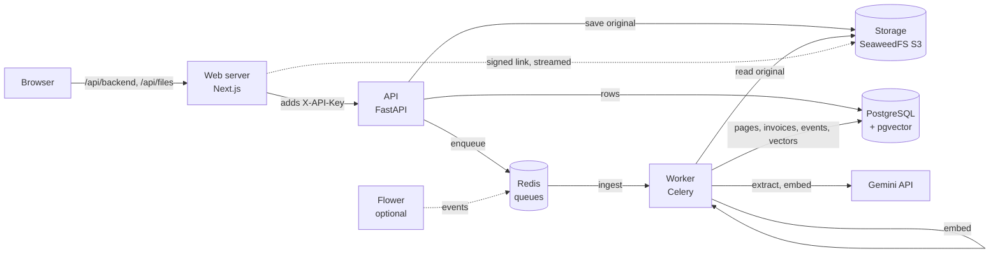

# AI Document Intelligence

Upload invoices and receipts (PDF, scanned PDF, JPG/PNG/TIFF, XLSX/XLS, CSV). The system reads the text (directly, or with OCR for scans), extracts structured invoice data with an LLM, validates it, lets a person review and correct it in a web UI, and makes everything searchable.

Docs: [API](docs/api.md) · [frontend](docs/frontend.md) · [database](docs/database-schema.md) · [testing](docs/testing.md) · [performance](docs/performance.md) · [monitoring](docs/monitoring.md) · [security](docs/security.md) · [AI disclosure](docs/ai-disclosure.md)

## Quick start

Needs Docker with Compose v2 and `make`.

```bash
cp .env.example .env     # then set GOOGLE_API_KEY (needed for extraction and semantic search)
make up                  # build and start, waits until healthy
make migrate             # create the database tables (also after pulling new migrations)
```

Open http://localhost:3000. The dot in the header is green when the API, database, Redis and storage are all up.

Without a `GOOGLE_API_KEY` the system still reads files, runs OCR, and does keyword search. Extraction and semantic search need the key.

To try it, generate sample documents (needs Python with [uv](https://docs.astral.sh/uv/) on the host) and drop them on the Upload page:

```bash
cd backend && uv sync && uv run python scripts/make_sample_documents.py
# writes backend/tests/fixtures/samples/ (git-ignored): PDFs, scans, TIFF, XLSX/XLS/CSV, a 60-page PDF, bulk/
```

Then try the pages described in [docs/frontend.md](docs/frontend.md#manual-test-from-the-browser).

```bash
make dev       # same stack in the foreground with live logs (Ctrl+C stops)
make down      # stop, keeps data
```

| Service | URL |
|---|---|
| Web | http://localhost:3000 |
| API docs | http://localhost:8000/docs |
| Flower (optional, `make flower`) | http://localhost:5555 |
| Postgres (localhost only) | localhost:15432 |

Also running: `redis`, `worker` (Celery), `storage` (S3 API on 8333, bucket created by `storage-init`). Flower shows the worker and its tasks; see [docs/monitoring.md](docs/monitoring.md).

Check it works:

```bash
docker compose ps -a                # services healthy, storage-init Exited (0)
curl -i localhost:8000/healthz      # 200 {"status":"ok"}
curl -i localhost:8000/readyz       # 200, database / redis / storage all "ok"
```

## How it works



1. **Upload.** The API checks the file type, stores the original in S3-compatible storage, records it in PostgreSQL and answers `202` at once. The same file (by SHA-256) is not stored twice.
2. **Ingest** (queue `ingest`). The worker detects the type and reads the text: PDFs through pypdfium2, spreadsheets through pandas/openpyxl/xlrd. Pages with no text layer, and images, go to OCR.
3. **OCR** (queue `ocr`). Tesseract after OpenCV cleanup (deskew, denoise, contrast); pages are read in parallel.
4. **Extract** (queue `llm`, rate limited). The page text goes to Gemini with a structured-output schema. Every field is optional and `null` when absent; the model must quote the source text for each value, and values are checked against the page.
5. **Validate.** Rules check arithmetic (lines, subtotal, tax, total), dates, currency, duplicates (same supplier and invoice number) and low confidence. Problems become findings, not silent fixes. A document with findings is `NEEDS_REVIEW`.
6. **Embed** (queue `embed`). Page text is chunked and embedded; keyword search uses PostgreSQL full-text search, semantic search uses pgvector, hybrid fuses both with reciprocal rank fusion.
7. **Review.** The web UI shows progress, the original beside the extracted invoice, findings on their fields, a correction form with an audit trail, reprocess and retry, and search.

Every stage is idempotent and logs to `processing_events` (stage, status, duration, error), which the document page shows as a timeline.

## Design choices

- **Text first, OCR only when needed.** Digital PDFs and spreadsheets skip OCR, which is slow and less accurate. Each page is decided on its own, so a mixed PDF is handled correctly.
- **The model extracts, code decides.** The prompt forbids guessing, rounding and calculating. Arithmetic, normalisation (money as decimals, ISO dates and currencies) and validation are plain code, so a wrong total is flagged, never quietly corrected.
- **Document text is data.** It is delimited in the prompt and the model is told to ignore any instructions in it.
- **Separate queues** (`ingest`, `ocr`, `llm`, `embed`) so slow OCR does not hold up ingest, and the model call has its own rate limit.
- **The browser never calls the API directly.** The web server forwards requests and adds the API key, and streams stored files, so the key stays on the server and storage needs no public address or CORS. See [docs/security.md](docs/security.md).
- **Money is `Decimal` in the API and a string in the browser,** never a float.
- **LangChain is a thin layer** (chat model, structured output, embeddings only).

## Tests

All run in throwaway Docker containers, so no local Python or Node is needed (except `make e2e`, which runs Playwright on the host). They never touch the running stack and never call the real LLM.

```bash
make test      # backend (pytest) + frontend (vitest)
make check     # lint, typecheck and all tests
make lint      # ruff, mypy, eslint, tsc
make e2e       # one browser journey against the running stack (make up first; installs Chromium once)
make bench     # slow large-document benchmarks
```

Run one backend test file:

```bash
docker compose --profile test run --build --rm backend-test pytest tests/unit/test_health.py -v
```

What each layer covers: [docs/testing.md](docs/testing.md).

## Configuration

- `.env.example` documents every variable. The API and worker refuse to start if one is missing or invalid, and name it.
- Secrets are masked in logs and never returned by any endpoint.
- Host ports are set in `.env` (`API_PORT`, `WEB_PORT`, `POSTGRES_PORT`, `REDIS_PORT`, `S3_PORT`, `FLOWER_PORT`).
- Models: `GEMINI_EXTRACTION_MODEL`, `GEMINI_FALLBACK_MODEL`, `EMBEDDING_MODEL`. Provider model IDs change; if extraction fails with a "model not found" error, check the IDs against your key's available models.
- `API_KEY` (optional locally) protects the API. The web server adds it to every call; change it in `.env`, then `docker compose up -d api web worker`.
- To restart after changing `.env`, run `make up` again; data is kept.

## Known limits

- **No evaluation.** The brief asks for an evaluation of extraction accuracy. It was not done: there was no labelled real-world dataset available in the time, and generated samples would only measure the generator. `make eval` is a placeholder and prints that. Extraction quality is therefore checked by tests with fake models and by manual runs, not measured.
- **No user accounts.** One shared API key; the editor name on a correction is typed in, not authenticated.
- **Model quota.** On a free-tier key the stronger model may be unavailable (quota or demand); a flash model is used for both extraction and fallback by default.
- **Previews.** TIFF and spreadsheets are offered as a download, not a preview. OCR shows no per-page percentage because the API does not report it.
- **Languages.** OCR and the prompt are tuned for English invoices; other languages are not tested.

## Troubleshooting

| Problem | Fix |
|---|---|
| `.env not found` | Run `cp .env.example .env`. |
| `port is already allocated` | Change that port in `.env` (and in `DATABASE_URL` for Postgres), then `make up`. |
| `/readyz` returns 503 | Check which dependency says `error`; the reason is in `docker compose logs api`. |
| Documents fail with a "model not found" error | The model ID is retired or not open to your key; set `GEMINI_EXTRACTION_MODEL` and `GEMINI_FALLBACK_MODEL` in `.env`, then `make up`. |
| Pages fail after pulling | Run `make migrate`. |
| Start over | `docker compose down -v && make up && make migrate` (deletes all data) |
