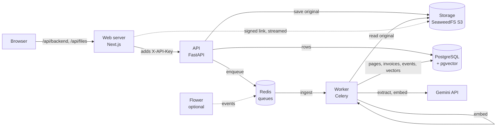

# AI Document Intelligence

Upload invoices and receipts (PDF, scanned PDF, JPG/PNG/TIFF, XLSX/XLS, CSV). The system reads the text (directly, or with OCR for scans), extracts structured invoice data with an LLM, validates it, lets a person review and correct it in a web UI, makes everything searchable, and answers questions in plain words from the stored text, with numbered citations.

Docs: [API](docs/api.md) · [frontend](docs/frontend.md) · [database](docs/database-schema.md) · [testing](docs/testing.md) · [evaluation](eval/results/report.md) · [performance](docs/performance.md) · [monitoring](docs/monitoring.md) · [security](docs/security.md) · [AI disclosure](docs/ai-disclosure.md)

## Quick start

Needs Docker with Compose v2 and `make`.

```bash
cp .env.example .env     # then set GOOGLE_API_KEY (needed for extraction and semantic search)
make up                  # build and start, waits until healthy
make migrate             # create the database tables (also after pulling new migrations)
```

Open http://localhost:3000. The dot in the header is green when the API, database, Redis and storage are all up.

Without a `GOOGLE_API_KEY` the system still reads files, runs OCR, and does keyword search. Extraction, semantic search and chat need the key.

To try it, generate sample documents (needs Python with [uv](https://docs.astral.sh/uv/) on the host) and drop them on the Upload page:

```bash
cd backend && uv sync && uv run python scripts/make_sample_documents.py
# writes backend/tests/fixtures/samples/ (git-ignored): PDFs, scans, TIFF, XLSX/XLS/CSV, a 60-page PDF, bulk/
```

Then try the pages described in [docs/frontend.md](docs/frontend.md#manual-test-from-the-browser).

```bash
make dev       # same stack in the foreground with live logs (Ctrl+C stops)
make down      # stop, keeps data
```

| Service | URL |
|---|---|
| Web | http://localhost:3000 |
| API docs | http://localhost:8000/docs |
| Flower (optional, `make flower`) | http://localhost:5555 |
| Postgres (localhost only) | localhost:15432 |

Also running: `redis`, `worker` (Celery), `storage` (S3 API on 8333, bucket created by `storage-init`). Flower shows the worker and its tasks; see [docs/monitoring.md](docs/monitoring.md).

Check it works:

```bash
docker compose ps -a                # services healthy, storage-init Exited (0)
curl -i localhost:8000/healthz      # 200 {"status":"ok"}
curl -i localhost:8000/readyz       # 200, database / redis / storage all "ok"
```

## How it works



1. **Upload.** The API checks the file type, stores the original in S3-compatible storage, records it in PostgreSQL and answers `202` at once. The same file (by SHA-256) is not stored twice.
2. **Ingest** (queue `ingest`). The worker detects the type and reads the text: PDFs through pypdfium2, spreadsheets through pandas/openpyxl/xlrd. Pages with no text layer, and images, go to OCR.
3. **OCR** (queue `ocr`). Tesseract after OpenCV cleanup (deskew, denoise, contrast); pages are read in parallel.
4. **Extract** (queue `llm`, rate limited). The page text goes to Gemini with a structured-output schema. Every field is optional and `null` when absent; the model must quote the source text for each value, and values are checked against the page.
5. **Validate.** Rules check arithmetic (lines, subtotal, tax, total), dates, currency, duplicates (same supplier and invoice number) and low confidence. Problems become findings, not silent fixes. A document with findings is `NEEDS_REVIEW`.
6. **Embed** (queue `embed`). Page text is chunked and embedded; keyword search uses PostgreSQL full-text search, semantic search uses pgvector, hybrid fuses both with reciprocal rank fusion. See [Search](#search).
7. **Review.** The web UI shows progress, the original beside the extracted invoice, findings on their fields, a correction form with an audit trail, reprocess and retry, and search.

Every stage is idempotent and logs to `processing_events` (stage, status, duration, error), which the document page shows as a timeline.

## Design choices

- **Text first, OCR only when needed.** Digital PDFs and spreadsheets skip OCR, which is slow and less accurate. Each page is decided on its own, so a mixed PDF is handled correctly.
- **The model extracts, code decides.** The prompt forbids guessing, rounding and calculating. Arithmetic, normalisation (money as decimals, ISO dates and currencies) and validation are plain code, so a wrong total is flagged, never quietly corrected.
- **Document text is data.** It is delimited in the prompt and the model is told to ignore any instructions in it.
- **Separate queues** (`ingest`, `ocr`, `llm`, `embed`) so slow OCR does not hold up ingest, and the model call has its own rate limit.
- **The browser never calls the API directly.** The web server forwards requests and adds the API key, and streams stored files, so the key stays on the server and storage needs no public address or CORS. See [docs/security.md](docs/security.md).
- **Money is `Decimal` in the API and a string in the browser,** never a float.
- **LangChain is a thin layer** (chat model, structured output, embeddings only).

## Search

Search works on **chunks**: after text extraction each page is cut into pieces of about 1000 characters (150 overlap, so a sentence at a boundary is whole in one piece). Each chunk is stored with a full-text index and, once the embed job has run, a vector. A result is the best chunk of each document, with its page number. All three modes accept the same filters as the document list (status, supplier, invoice number, dates, amounts, currency). Pick the mode on the Search page, or with `mode=` on `GET /api/v1/search`.

| Mode | Finds | Good for | Weak at |
|---|---|---|---|
| **Keyword** | chunks that contain the words | invoice numbers, names, exact amounts, quoted phrases | synonyms and questions: "bakery" does not find "croissant" |
| **Semantic** | chunks with a similar meaning | questions and descriptions: "which supplier sells bakery products" | exact identifiers; a single generic word |
| **Hybrid** (default) | both, merged | most searches | nothing in particular, but it needs the embeddings for the semantic half |

**Keyword** uses PostgreSQL full-text search (a `tsvector` column with a GIN index, the `simple` configuration, so words match as written in any language and there is no stemming). The query is read as web-search syntax: words are ANDed, `"quoted phrases"` match as a phrase, and `-word` excludes. The match is highlighted in the snippet. Because every word must be present, a long question usually matches nothing; use few, specific words.

**Semantic** turns the chunk and the query into vectors (Gemini `models/gemini-embedding-001`, 768 numbers) and returns the chunks closest in direction (cosine distance, pgvector HNSW index). It finds text that means the same without sharing words. It always returns the closest chunks, even when none is relevant, and its scores sit close together (on the sample set most are between 0.60 and 0.65), so read the order, not the number. It needs `GOOGLE_API_KEY`, and a chunk can only be found once its embedding exists.

**Hybrid** runs both and merges the two rankings with reciprocal rank fusion: a chunk's score is the sum of `1 / (60 + rank)` over the lists it appears in. A chunk near the top of both lists beats one at the top of only one, and no score tuning is needed because only ranks are used. Exact identifiers come from the keyword side and fuzzy questions from the semantic side.

**Fallbacks.** Without a key, hybrid becomes keyword search and the response says so (`mode_used`); semantic returns 409 `semantic_unavailable`. If embeddings are missing or failed, semantic and hybrid return nothing from the vector side while keyword keeps working, so check the embed events on the document page (see [Troubleshooting](#troubleshooting)).

| Example | Use |
|---|---|
| `EV-1011` | keyword or hybrid |
| `"payment terms"` | keyword or hybrid |
| `which supplier sells bakery products` | semantic or hybrid |
| `cloud hosting invoice` | semantic or hybrid |

## Chat

The Chat page (`/chat`, API `POST /api/v1/chat`) answers a question in words, from the text of your documents, and shows where each claim came from.

1. The question is matched against the chunks with the same ranking as hybrid search, within the page's filters.
2. Only relevant chunks are kept: at most 6, two per document, 4000 characters. A chunk is relevant if it matched the words, or its meaning is close enough to the question (similarity of at least 0.62, a value set from nine questions on the sample invoices; it is a starting point, not a measured optimum).
3. The model (the configured Gemini extraction model) gets those chunks and the question, and is told to answer only from them, cite with `[n]`, and say so when they do not answer. The chunks are delimited as data, as in extraction.
4. The answer streams in. Each `[n]` is a chip that shows the quote of source n; the sources the answer cites are listed beside it (answer left, numbered list right, only the cited ones once it is done) and link to the document, and hovering a chip highlights its source. A `[n]` that names no source is not shown. The answer ends with up to three suggested follow-up questions, produced by the same call.
5. For a follow-up, the question is first rewritten into one that stands alone, using the last three stored turns of the chat; only that rewrite sees the history, so the answering call stays small. When nothing relevant is found no model call is made and the page says so.

Cost on the sample invoices (one observation, not a benchmark): an answer used about 1000 to 1500 input tokens and under 150 output tokens, a rewrite about 175 input tokens, and an answer took about two seconds. Every model call logs its model and token counts, never the text.

6. Chats are saved. Each conversation is a session with a title (the first question, which you can rename); questions, answers, their sources and follow-ups are kept in the database, so a reload or the session list brings a conversation back exactly as it was, and a chat can be deleted. A stopped or failed answer is kept too and marked as such.

What it does not do: it has no accounts, so every saved chat is visible to everyone who can reach the web server, and the text is stored unencrypted until the chat is deleted; it cannot answer questions that need every document at once ("total spend per supplier"), because it reads a handful of chunks, and it does not search the web. A citation shows that a source was retrieved, not that it supports the sentence; whether it does is not measured, and the evaluation report does not cover chat. Check the quote.

## Tests

All run in throwaway Docker containers, so no local Python or Node is needed (except `make e2e`, which runs Playwright on the host). They never touch the running stack and never call the real LLM.

```bash
make test      # backend (pytest) + frontend (vitest)
make check     # lint, typecheck and all tests
make lint      # ruff, mypy, eslint, tsc
make e2e       # one browser journey against the running stack (make up first; installs Chromium once)
make bench     # slow large-document benchmarks
make eval      # evaluation on the labelled dataset: real model calls, run by hand (see Evaluation)
```

Run one backend test file:

```bash
docker compose --profile test run --build --rm backend-test pytest tests/unit/test_health.py -v
```

What each layer covers: [docs/testing.md](docs/testing.md).

## Evaluation

`make eval` runs a labelled dataset (33 generated documents: every file type, four image quality levels, absent fields, seeded errors, and files that must fail) through the real API and model and writes [eval/results/report.md](eval/results/report.md). How it works, the scoring rules and how to add real documents: [eval/README.md](eval/README.md).

Results of the committed run (details, failures and limits are in the report):

| Measure | Result |
|---|---|
| Documents expected to succeed that finished | 100% (29 of 29) |
| Expected failures and refusals handled as labelled | 100% (4 of 4); no unexpected failure |
| Documents with every field correct | 86.2% (25 of 29) |
| Seeded validation errors flagged | 3 of 3; 0 of 26 clean documents sent to review |
| Typical time, PDF or image, end to end | about 3 s (median); 4.7 documents per minute at concurrency 2 |

The weak spot is image quality: the lowest-quality image gave six wrong fields (including an amount off by a factor of 100) and was not sent to review. The run used two extraction models because of the provider's free-tier daily limit; the report splits the results by model. The documents are synthetic, so these figures are an upper bound for real invoices.

## Configuration

- `.env.example` documents every variable. The API and worker refuse to start if one is missing or invalid, and name it.
- Secrets are masked in logs and never returned by any endpoint.
- Host ports are set in `.env` (`API_PORT`, `WEB_PORT`, `POSTGRES_PORT`, `REDIS_PORT`, `S3_PORT`, `FLOWER_PORT`).
- Models: `GEMINI_EXTRACTION_MODEL`, `GEMINI_FALLBACK_MODEL`, `EMBEDDING_MODEL`. Provider model IDs change; if extraction fails with a "model not found" error, check the IDs against your key's available models.
- `API_KEY` (optional locally) protects the API. The web server adds it to every call; change it in `.env`, then `docker compose up -d api web worker`.
- To restart after changing `.env`, run `make up` again; data is kept.

## Known limits

- **The evaluation is small and synthetic.** It ran on 33 generated documents with known true values (see [Evaluation](#evaluation)), not on real invoices, so it shows that the pipeline works and where it is weak, not how accurate it is in the real world. Damaged scans can produce wrong values that validation does not catch.
- **Chat is not evaluated, and its saved chats are shared.** See [Chat](#chat): answers are read from a few chunks, citations are not checked for support, and saved conversations are stored as plain text, visible to everyone with access (there are no accounts).
- **No user accounts.** One shared API key; the editor name on a correction is typed in, not authenticated.
- **Model quota.** On a free-tier key the stronger model may be unavailable (quota or demand); a flash model is used for both extraction and fallback by default. The free tier allows about 20 requests a day per model, and a chat question costs one (two with history), so a demo has room for a handful of questions.
- **Previews.** TIFF and spreadsheets are offered as a download, not a preview. OCR shows no per-page percentage because the API does not report it.
- **Languages.** OCR and the prompt are tuned for English invoices; other languages are not tested.

## Troubleshooting

| Problem | Fix |
|---|---|
| `.env not found` | Run `cp .env.example .env`. |
| `port is already allocated` | Change that port in `.env` (and in `DATABASE_URL` for Postgres), then `make up`. |
| `/readyz` returns 503 | Check which dependency says `error`; the reason is in `docker compose logs api`. |
| Semantic search returns nothing, hybrid acts like keyword | The embedding model is not available to your key (check `EMBEDDING_MODEL`; the default is `models/gemini-embedding-001`) or the embed jobs failed. Look for failed `embed` events on the document page, fix `.env`, run `make up`, then re-embed (re-upload, or queue the embed job again). |
| Documents fail with a "model not found" error | The model ID is retired or not open to your key; set `GEMINI_EXTRACTION_MODEL` and `GEMINI_FALLBACK_MODEL` in `.env`, then `make up`. |
| Pages fail after pulling | Run `make migrate`. |
| Start over | `docker compose down -v && make up && make migrate` (deletes all data) |
