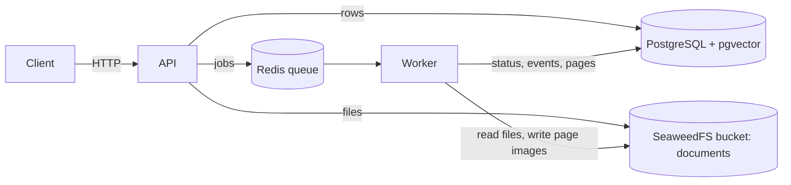
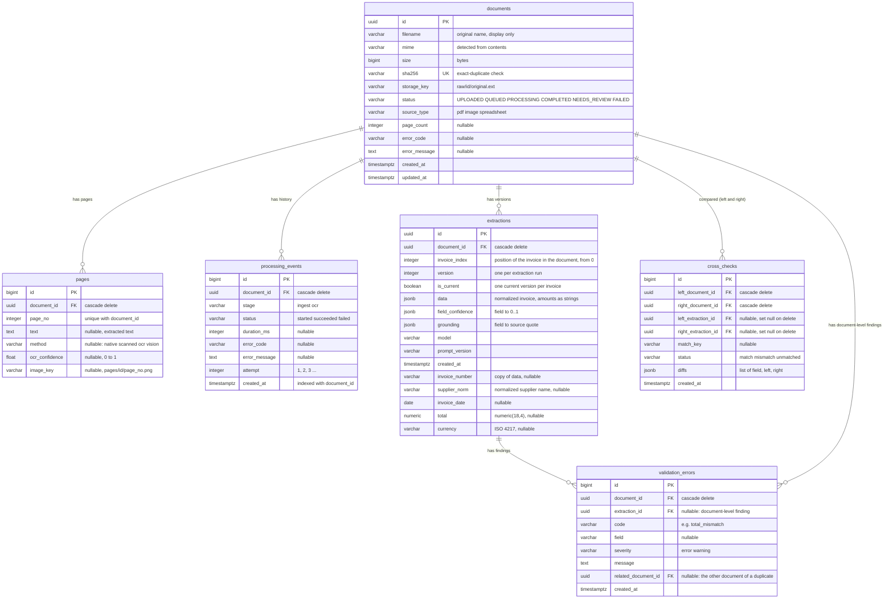

# Database schema

PostgreSQL 16 with the `pgvector` extension. Models live in `backend/app/db/models/`, migrations in `backend/alembic/versions/`. Keep this file in sync with both.

## Where data lives

- **PostgreSQL** holds every structured fact: documents, pages, events, and later extractions and search data.
- **SeaweedFS** holds the files. A document row points to its file through `documents.storage_key`.
- **Redis** holds only the job queue. Nothing in it is permanent.
- **Vector search** is the `pgvector` extension inside PostgreSQL, not a separate database. It is enabled; the vector column arrives with `chunks` (Phase 4).

## Entities that exist now

Migration `0001` (documents, pages, processing events) and `0002` (extractions, validation errors, cross-checks).

Constraints and indexes:

| Table | Constraint / index |
|---|---|
| `documents` | primary key `id`; unique `sha256` (also the duplicate lookup index) |
| `pages` | primary key `id`; foreign key `document_id` with cascade delete; unique `(document_id, page_no)` |
| `processing_events` | primary key `id`; foreign key `document_id` with cascade delete; index `(document_id, created_at)` |
| `extractions` | primary key `id`; foreign key `document_id` with cascade delete; unique `(document_id, invoice_index, version)`; index `(supplier_norm, invoice_number)` (duplicate lookup); index `(document_id, is_current)` |
| `validation_errors` | primary key `id`; foreign keys `document_id` and `extraction_id` with cascade delete, `related_document_id` set null on delete |
| `cross_checks` | primary key `id`; foreign keys `left_document_id` and `right_document_id` with cascade delete, `left_extraction_id` and `right_extraction_id` set null on delete; index `(left_document_id, right_document_id)` |

Rules worth knowing:
- Deleting a document deletes its pages and events (database-level cascade).
- `status` is a plain string checked in code (`DocumentStatus`), so new statuses need no migration.
- `pages.method`: `native` (text read from the PDF), `scanned` (almost no text, waiting for OCR: `text` is null and `image_key` is set), `ocr` (text read by Tesseract from the page image) and `vision` (set by a later change).
- `ocr_confidence` is the mean Tesseract word confidence on a 0 to 1 scale; NULL for native pages, for pages with no recognised words, and again whenever a page is re-saved by ingestion (a re-run starts clean and OCR fills it in again).
- Scanned-page lifecycle: ingestion saves the page as `scanned` (text NULL, image stored) -> OCR job sets `text`, `method=ocr`, `ocr_confidence`. A blank page ends as `ocr` with empty text.
- Spreadsheet pages (XLSX, XLS, CSV) are saved as `native` with the table as text and no image. Each sheet with data gives one page per 100 data rows; page numbers run across sheets in order. A page starts with `Sheet: <name>` (`Sheet: <name> (continued)` after the first page of a sheet), then, on the first page only, any rows above the table, then the header line (repeated on every page of the sheet), then the data rows. Cells are separated by ` | `; empty rows and trailing empty columns are dropped, merged cells repeat their value, dates are ISO 8601 and numbers have no float noise. A CSV is one sheet named after the file.
- Every frame of an image file (JPG, PNG, each TIFF frame) is saved as a `scanned` page. Only scanned pages get an image, stored at `pages/<document_id>/<page_no>.png` (300 DPI PNG). Text pages are not rendered.
- Re-processing a document updates its page rows in place (upsert on `(document_id, page_no)`).
- Storage keys are built from the document id and a type-derived extension, never from the client filename.
- Extractions are versioned: each extraction run inserts new rows with the next `version` and sets earlier versions of the document's invoices to `is_current = false`. Reads use `is_current = true`.
- An invoice's position in the document (`invoice_index`) identifies it across versions. A document with several invoices has several rows per version; a document with none has no rows and a document-level `no_invoice_found` finding.
- `data` holds the normalized invoice including its line items (description, quantity, unit price, amount) with amounts as strings. There is no `line_items` table: nothing queries lines yet. The scalar columns (`invoice_number`, `supplier_norm`, `invoice_date`, `total`, `currency`) are copies of `data` for indexed lookups; `total` is `numeric`, never float.
- `validation_errors` rows of an invoice are replaced when it is validated again. `validation_errors.extraction_id` is null for findings about the whole document.
- `cross_checks` rows of a pair of documents are replaced when the pair is compared again. A row with one extraction id null is an invoice with no match on that side.

## Planned entities

Not created yet. Columns are indicative and will be fixed by the change that adds them.

| Planned table | Phase | Purpose |
|---|---|---|
| `corrections` | 4 | manual edits with who and when; a correction writes a new `extractions` version |
| `chunks` | 4 | text pieces for keyword and semantic search; the `embedding vector(N)` size must match the embedding model chosen then |

Dropped from the original sketch: `documents.parent_id` (a document holding several invoices keeps one row per invoice in `extractions` instead of child documents) and `line_items` (line items live in `extractions.data`).
