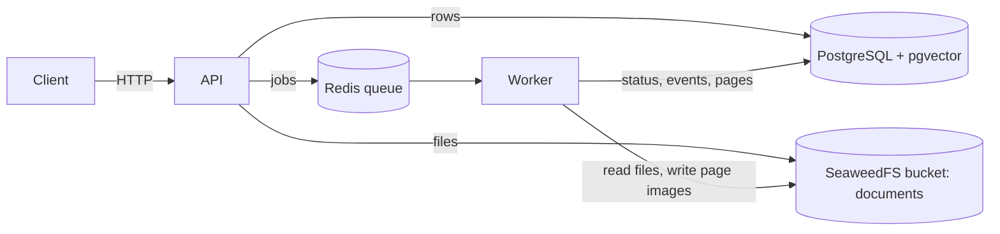
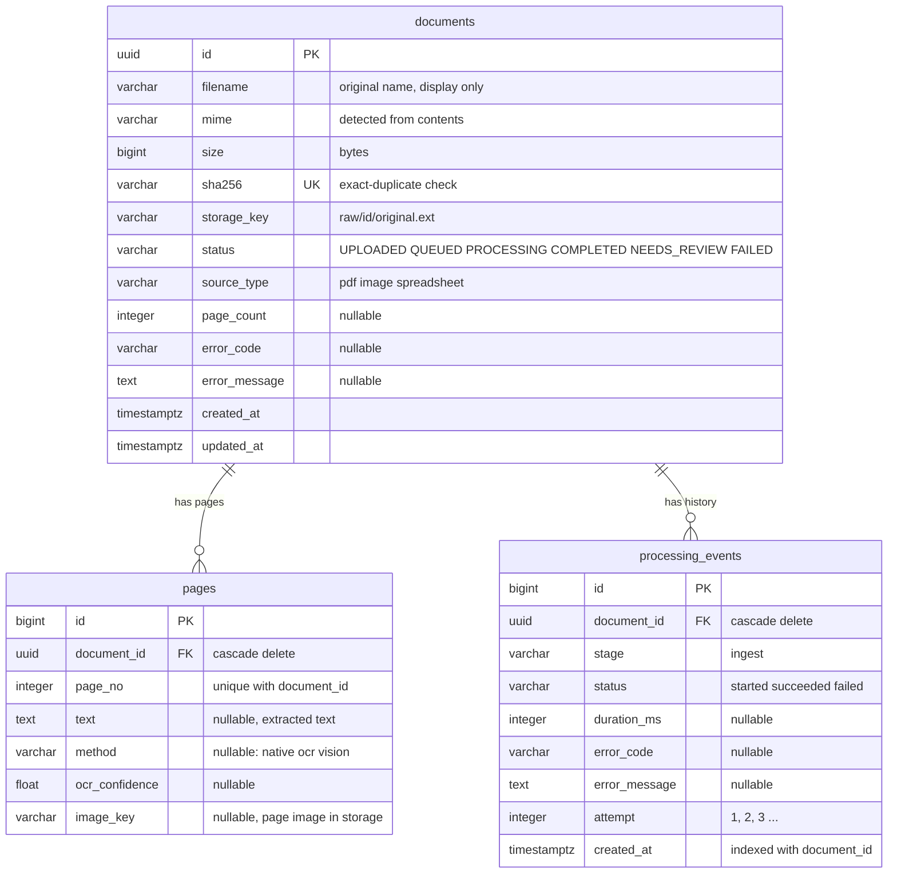
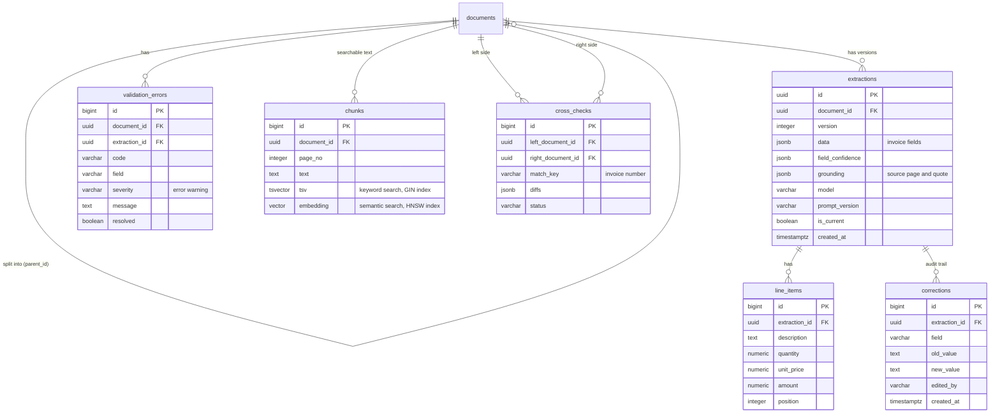

# Database schema

PostgreSQL 16 with the `pgvector` extension. Models live in `backend/app/db/models/`, migrations in `backend/alembic/versions/`. Keep this file in sync with both.

## Where data lives

- **PostgreSQL** holds every structured fact: documents, pages, events, and later extractions and search data.
- **SeaweedFS** holds the files. A document row points to its file through `documents.storage_key`.
- **Redis** holds only the job queue. Nothing in it is permanent.
- **Vector search** is the `pgvector` extension inside PostgreSQL, not a separate database. It is enabled; the vector column arrives with `chunks` (Phase 4).

## Entities that exist now

Migration `0001`.

Constraints and indexes:

| Table | Constraint / index |
|---|---|
| `documents` | primary key `id`; unique `sha256` (also the duplicate lookup index) |
| `pages` | primary key `id`; foreign key `document_id` with cascade delete; unique `(document_id, page_no)` |
| `processing_events` | primary key `id`; foreign key `document_id` with cascade delete; index `(document_id, created_at)` |

Rules worth knowing:
- Deleting a document deletes its pages and events (database-level cascade).
- `status` is a plain string checked in code (`DocumentStatus`), so new statuses need no migration.
- Storage keys are built from the document id and a type-derived extension, never from the client filename.

## Planned entities

Not created yet. Shown so the whole model is visible. Columns are indicative and will be fixed by each phase's change.

| Planned table | Phase | Purpose |
|---|---|---|
| `documents.parent_id` (new column) | 2 | a PDF holding several invoices is split into child documents |
| `extractions`, `line_items` | 2 | structured invoice data from Gemini, versioned; money columns are `numeric`, never float |
| `validation_errors`, `cross_checks` | 3 | rule failures, and comparisons between documents |
| `corrections` | 4 | manual edits with who and when |
| `chunks` | 4 | text pieces for keyword and semantic search; the `embedding vector(N)` size must match the embedding model pinned in Phase 2 |
